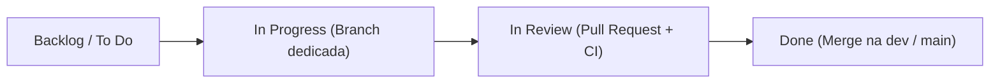

# Artel

Aplicação de divisão de despesas em grupo — projeto acadêmico da disciplina **C14 — Engenharia de Software** do **Instituto Nacional de Telecomunicações (Inatel)**.

## Sobre o Projeto

O **Artel** é uma aplicação web e API REST voltada para o gerenciamento e a **divisão justa de despesas compartilhadas** em grupos — como viagens, repúblicas estudantis, churrascos e eventos entre amigos. O sistema elimina planilhas manuais e cálculos confusos ao centralizar o histórico de gastos, automatizar o rateio e reduzir o número de pagamentos necessários para acertar as contas.

Principais capacidades implementadas:

- **Grupos e participantes:** criação e gestão de grupos de despesas, inclusão e remoção segura de membros (impedindo a remoção do criador ou de participantes com pendências financeiras), com autenticação via Laravel Sanctum e controle de acesso por grupo (`GroupPolicy`).
- **Rateio flexível com precisão em centavos:** registro e edição de despesas com divisão **igualitária** (entre todos ou um subconjunto de participantes), por **valores exatos** ou por **percentuais**, tratando centavos residuais sem perdas de arredondamento.
- **Balanço e quitações:** apuração automática do total pago, total devido e saldo líquido de cada integrante (`a_receber`, `a_pagar` ou `quitado`), com registro e histórico de acertos parciais ou totais entre membros.
- **Simplificação de dívidas:** algoritmo que analisa os saldos líquidos do grupo e sugere o **número mínimo de transferências (PIX)** necessárias para quitar todas as pendências.

### Origem do termo *Artel*

O nome **Artel** (do russo *арте́ль*) inspira-se nas históricas associações cooperativas voluntárias do Leste Europeu, nas quais artesãos, trabalhadores ou viajantes se uniam para executar empreitadas em conjunto, compartilhando custos, recursos e responsabilidades de maneira solidária, transparente e igualitária — princípio que reflete diretamente a proposta do projeto para a gestão coletiva de despesas.

## Requisitos do Sistema

### Requisitos Funcionais (RF)

| Código | Requisito | Descrição |
|---|---|---|
| **RF01** | **Autenticação e controle de acesso** | Permitir o cadastro, login e logout de usuários (via tokens Laravel Sanctum na API e sessão nas telas web), restringindo o acesso aos recursos de cada grupo apenas ao dono e aos seus participantes (`GroupPolicy`). |
| **RF02** | **Gerenciamento de grupos** | Permitir criar, listar, visualizar detalhes, atualizar o nome e excluir grupos de despesas, sendo a renomeação e a exclusão exclusivas do proprietário do grupo. |
| **RF03** | **Inclusão automática do criador** | Vincular automaticamente o usuário criador como proprietário (`user_id`) e participante inicial do grupo no momento de sua criação. |
| **RF04** | **Gestão de participantes do grupo** | Permitir listar, adicionar (por `email` ou `user_id`) e remover participantes do grupo, bloqueando a remoção do criador ou de membros que possuam saldo pendente ou despesas ativas como pagador. |
| **RF05** | **Registro de despesas** | Permitir o lançamento de despesas em um grupo informando descrição (`description`), valor total (`amount`), membro pagador (`paid_by`) e modalidade de divisão (`split_type`). |
| **RF06** | **Divisão igualitária e customizada** | Suportar o rateio de despesas em três modalidades (`SplitType`): **igualitária (`equal`)** entre todos ou um subconjunto de membros, por **valores exatos (`exact`)** ou por **percentuais (`percentage`)**, distribuindo centavos residuais para que a soma das parcelas feche exatamente com o valor da despesa. |
| **RF07** | **Histórico, edição e exclusão de despesas** | Permitir listar o histórico de despesas do grupo, consultar os detalhes e parcelas de um lançamento, editar integralmente uma despesa (recalculando suas parcelas) e excluí-la. |
| **RF08** | **Cálculo automático de saldos** | Apurar automaticamente para cada participante o total pago (`total_paid`), o total devido (`total_owed`), o saldo líquido (`net_balance`, considerando quitações) e o status financeiro (`a_receber`, `a_pagar` ou `quitado`). |
| **RF09** | **Simplificação de dívidas** | Calcular e sugerir uma lista enxuta de transferências (`suggested_transfers`) que minimize o número total de pagamentos entre devedores e credores para zerar os saldos do grupo. |
| **RF10** | **Registro e histórico de quitações** | Permitir marcar dívidas como quitadas (total ou parcialmente) entre dois participantes do grupo (`settlements`), listando o histórico de acertos e abatendo automaticamente os valores no cálculo de saldo. |

### Requisitos Não Funcionais (RNF)

| Código | Categoria | Especificação Técnica |
|---|---|---|
| **RNF01** | **Arquitetura e Manutenibilidade** | Aplicação estruturada em monorepo **Laravel 13 (PHP 8.4+)** com separação de responsabilidades em camadas (*Controllers, Form Requests, Services, Strategies/Enums, Policies e Eloquent Models*) e interface web em **Blade + Tailwind CSS (Vite)**. |
| **RNF02** | **Precisão Monetária e Transações (ACID)** | Cálculos de rateio e simplificação de dívidas processados em **centavos inteiros** para eliminar erros de ponto flutuante; escritas críticas encapsuladas em transações atômicas (`DB::transaction`) e integridade referencial com exclusão em cascata (`cascadeOnDelete`). |
| **RNF03** | **Segurança e Validação** | Senhas armazenadas com hash seguro (`bcrypt`), autenticação via tokens **Laravel Sanctum** com proteção contra força bruta (*rate limiting*), autorização em nível de rota/request (`GroupPolicy`), validação estrita via *Form Requests* e verificação de vulnerabilidades com `composer audit`. |
| **RNF04** | **Padronização e Análise Estática** | Conformidade obrigatória com o padrão de código PSR-12 / Laravel verificada pelo **Laravel Pint** (`make lint`) e análise estática de tipos com **Larastan / PHPStan** (`make analyse`). |
| **RNF05** | **Testabilidade e Confiabilidade** | Suíte automatizada de testes **Unitários e de Feature** com **PHPUnit 12** e **Mockery**, executada em banco **SQLite em memória (`:memory:`)** isolado e com geração de métricas de cobertura via **PCOV**. |
| **RNF06** | **Portabilidade e Containerização** | Ambiente de execução reprodutível empacotado com **Docker** e **Docker Compose** (`Dockerfile`, `compose.yml` e entrypoint automatizado de migrações), além de automação de desenvolvimento local via **GNU Make** (`Makefile`). |
| **RNF07** | **Integração e Entrega Contínua (CI/CD)** | Pipeline declarativa no **Jenkins** (`Jenkinsfile`) com estágios bloqueantes de *Build*, *Quality* (Pint, Larastan e Audit), *Testes e Cobertura* (JUnit + Cobertura XML/HTML), *Package* (`.tar.gz` + `sha256`) e *Deploy + Smoke Test* automático no **Fly.io** na branch `main`. |
| **RNF08** | **Usabilidade, Padronização REST e Documentação** | API RESTful com respostas padronizadas em JSON (`401`, `403`, `404`, `422`) e mensagens de validação em português (PT-BR), acompanhada de portal de documentação técnica em **MkDocs Material** (`mkdocs build --strict`). |

## Gestão Ágil

O desenvolvimento do projeto segue práticas de **Gestão Ágil** apoiadas por um quadro **Kanban** centralizado no GitHub Projects da organização, garantindo rastreabilidade entre histórias de usuário, tarefas técnicas, branches e Pull Requests:

- **Quadro Kanban do Projeto:** [kanban - artel (view)](https://github.com/orgs/C14-Inatel-2026-2/projects/8/views/1)

### Fluxo de trabalho do grupo



1. **Planejamento e Backlog:** As entregas são decompostas em *User Stories* (`US01` a `US09`) e *Tasks* técnicas numeradas nas Issues do repositório, especificando objetivo, critérios de aceite e checklist técnico.
2. **Desenvolvimento em Branches Isoladas:** Cada integrante assume um card no Kanban, move-o para andamento e desenvolve em uma branch dedicada a partir da `dev` (`feat/*`, `refactor/*`, `test/*`, `ci/*`, `documentation/*`).
3. **Code Review e Qualidade (Definition of Done):** Ao concluir a tarefa, é aberto um *Pull Request* vinculado à issue correspondente. O card só avança para concluído após revisão por pares da equipe e aprovação nas verificações de qualidade (`make lint` com Laravel Pint, `make analyse` com Larastan, `make audit` com Composer Audit e suíte automatizada com `make test`).
4. **Integração e Entrega Contínua:** As alterações consolidadas na `dev` são promovidas para a `main`, disparando a pipeline do Jenkins para build, testes, empacotamento e deploy automático no Fly.io.

## Integrantes

| Nome Completo | GitHub |
|---|---|
| Davi Marcondes Ferreira | [@Davizin06](https://github.com/Davizin06) |
| João Carlos de Oliveira Mexias | [@Jhoncy6](https://github.com/Jhoncy6) |
| Millene Silva Toledo | [@pudimih](https://github.com/pudimih) |
| Vinicius Sávio Medina | [@Psychovv](https://github.com/Psychovv) |

## Demo

- URL: [https://artel-c14.fly.dev](https://artel-c14.fly.dev)
- Health: `GET /up`
- API (ex.): `POST /api/auth/login` e, com o token, `GET /api/groups`

> **Atenção:** a demo é um ambiente de demonstração. Não use dados reais.
>
> Entre demos o app pode estar **pausado** (`fly scale count 0`) para não gerar custo de máquina. Um novo build da `main` no Jenkins volta a publicar no Fly. Veja [CI/CD e deploy](docs/ci-cd.md).

## Guia de execução

Instruções práticas de instalação, execução (Docker e local), testes, lint e documentação. Detalhes em [`docs/`](docs/index.md).

### Docker Compose

Requisitos: Docker e Docker Compose. PHP, Composer, Apache e SQLite rodam no container.

```bash
docker compose up -d --build
```

App em [http://localhost:8000](http://localhost:8000). O entrypoint aplica as migrations ao subir.

```bash
docker compose ps                                     # status
docker compose exec app php artisan migrate:status    # migrations
docker compose logs -f app                            # logs
docker compose down                                   # parar
```

A imagem é de produção (`--no-dev`); testes e lint rodam no ambiente local ou na pipeline — não dentro do container.

### Localmente (Makefile)

Requisitos: PHP 8.4+ (`pdo_sqlite`), Composer, GNU Make e, para a UI, Node.js + npm.

```bash
make test     # PHPUnit
make lint     # Laravel Pint (somente leitura)
make analyse  # Larastan (análise estática)
make audit    # vulnerabilidades nas dependências
composer setup      # deps, .env, chave, migrations e build dos assets (primeira vez)
make install        # composer install (dependências PHP)
make serve          # http://127.0.0.1:8000
make docs-serve     # MkDocs em http://127.0.0.1:8001 (requer .venv ativo)
```

Outros atalhos: `make help`, `make migrate`, `make migrate-status`, `make lint-fix`, `make docs-build`. Guia completo: [Comandos úteis](docs/comandos.md). Setup do MkDocs: [Documentação](docs/documentacao.md).

### CI/CD (Jenkins)

Pipeline definida em [`Jenkinsfile`](Jenkinsfile): **Build → Quality → Testes e Cobertura → Package** e, na `main`, **Deploy e Smoke Test** no Fly.io.

- Visão geral: [CI/CD e deploy](docs/ci-cd.md)
- Servidor local: [`ci/jenkins/`](ci/jenkins/README.md)

## Refactorings

Consolidação da US09: cada integrante aplicou ≥2 refactorings. Formato: smell, técnica, motivo e link do PR.

### Psychovv

| Smell | Refactoring | Por quê | PR |
|---|---|---|---|
| Código duplicado: `$group->members()->where(...)->exists()` repetido em `GroupMemberController`, `StoreExpenseRequest`, `StoreSettlementRequest` e `GroupPolicy` | Extract Method (`Group::hasMember`) | Centraliza a checagem de participação no grupo, evitando drift entre controllers, Form Requests e policies | [#82](https://github.com/C14-Inatel-2026-2/Artel/pull/82) |
| Dead code: model `GroupMember` nunca era instanciado — a relação `group_members` já é manipulada via `Group::members()` (pivô `belongsToMany`) | Remove Dead Code | Remove uma classe sem uso real, que só confundia quem lia a arquitetura do projeto (documentada em `docs/arquitetura.md` como não utilizada) | [#82](https://github.com/C14-Inatel-2026-2/Artel/pull/82) |

### Davizin06

| Smell | Refactoring | Por quê | PR |
|---|---|---|---|
| Controller gordo: `SettlementController` misturava HTTP com listagem/criação de quitações | Extract Class (`SettlementService`) | Isola a regra de acertos na camada de serviço, no mesmo padrão de `ExpenseService` | [#87](https://github.com/C14-Inatel-2026-2/Artel/pull/87) |
| Long Method: `DebtSimplificationService::suggestTransfers` misturava partição de saldos e matching de transferências | Extract Method (`partitionBalances`, `matchTransfers`) | Separa as etapas do algoritmo de simplificação, facilitando leitura e manutenção | [#87](https://github.com/C14-Inatel-2026-2/Artel/pull/87) |

### pudimih

| Smell | Refactoring | Por quê | PR |
|---|---|---|---|
| Dead code: `ExampleTest` do skeleton Laravel (Feature e Unit) sem valor de regressão | Remove Dead Code | Elimina placeholders da suíte e a documentação que os tratava como testes reais | [#88](https://github.com/C14-Inatel-2026-2/Artel/pull/88) |
| Switch/`match` em `split_type` concentrava equal/exact/percentage dentro de `ExpenseService` | Replace Conditional with Polymorphism (Strategy: `EqualSplitStrategy`, `ExactSplitStrategy`, `PercentageSplitStrategy` + factory) | Cada tipo de divisão fica isolado e testável; `ExpenseService` só orquestra create/update/balance | [#88](https://github.com/C14-Inatel-2026-2/Artel/pull/88) |

### Jhoncy6

| Smell | Refactoring | Por quê | PR |
|---|---|---|---|
| Long Method e código duplicado em `ExpenseService`: `calculateBalance` misturava saldo/status/resumo, e create/update repetiam atributos e eager load | Extract Method (`memberBalance`, `balanceStatus`, `expenseAttributes`, `withRelations`) | Encurta `calculateBalance` e remove a duplicação entre criar e editar despesa, sem mudar o comportamento | [#92](https://github.com/C14-Inatel-2026-2/Artel/pull/92) |
| Primitive obsession: strings `"equal"`, `"exact"` e `"percentage"` soltas na request, no serviço e na factory | Replace Magic String with Enum (`SplitType`) | Tipa os tipos de divisão num enum único, evitando typos e espalhamento de literais | [#92](https://github.com/C14-Inatel-2026-2/Artel/pull/92) |

## Documentação

A documentação técnica fica em [`docs/`](docs/index.md) (MkDocs):

- [Instalação e execução](docs/instalacao.md)
- [Comandos úteis (Makefile)](docs/comandos.md)
- [Arquitetura](docs/arquitetura.md)
- [API](docs/api.md)
- [Testes](docs/testes.md)
- [CI/CD e deploy](docs/ci-cd.md)
- [Decisões arquiteturais](docs/decisoes.md)
