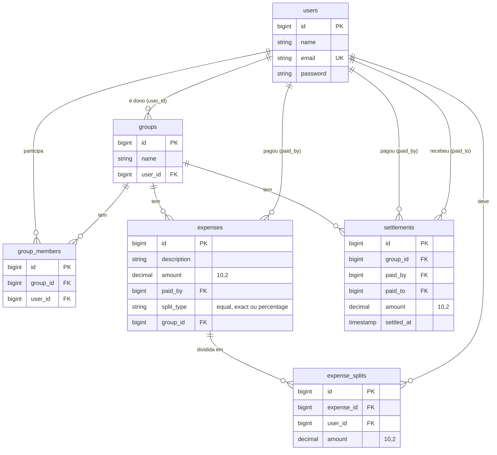

# Arquitetura

O Artel segue a estrutura padrão de uma aplicação Laravel, com uma camada de serviço para a regra de negócio de despesas.

## Organização do código

```text
app/
├── Http/
│   ├── Controllers/
│   │   ├── GroupController.php         # CRUD de grupos
│   │   ├── GroupMemberController.php   # Participantes do grupo
│   │   ├── ExpenseController.php       # Despesas (delega ao ExpenseService)
│   │   ├── GroupBalanceController.php  # Saldos (delega ao ExpenseService)
│   │   ├── SettlementController.php    # Quitações / acertos entre participantes
│   │   └── User/
│   │       ├── RegisterController.php  # Cadastro (rota web)
│   │       └── LoginController.php     # Login por sessão (rota web)
│   └── Requests/                       # Form Requests (validação)
│       ├── StoreGroupRequest.php
│       ├── UpdateGroupRequest.php
│       ├── AddGroupMemberRequest.php
│       ├── StoreExpenseRequest.php
│       └── StoreSettlementRequest.php
├── Models/                             # Eloquent: User, Group, Expense, ExpenseSplit, Settlement
├── Policies/GroupPolicy.php            # Regras de autorização (ainda não aplicadas)
└── Services/
    ├── ExpenseService.php              # Divisão de despesas e cálculo de saldos
    └── DebtSimplificationService.php   # Sugestão mínima de transferências (centavos)
routes/
├── api.php                             # Rotas REST, prefixo /api
├── web.php                             # Rota "/" e inclusão de user.php
└── user.php                            # /user/register e /user/login
```

O roteamento é configurado em `bootstrap/app.php`. Nesse arquivo também está definido que exceções são renderizadas como JSON para requisições em `api/*` ou que enviem `Accept: application/json`.

## Responsabilidades das camadas

| Camada | Responsabilidade | Observações |
|---|---|---|
| Rotas | Mapear URL e método HTTP para o controller | Usam *route model binding* (`{group}`, `{expense}`, `{user}`): um ID inexistente resulta em 404. |
| Form Requests | Validar a entrada e definir mensagens em português | `authorize()` sempre retorna `true`. `StoreExpenseRequest` e `StoreSettlementRequest` também verificam se os usuários envolvidos participam do grupo. |
| Controllers | Orquestrar a requisição e montar a resposta JSON | `GroupController`, `GroupMemberController` e `SettlementController` acessam os models diretamente. `ExpenseController` e `GroupBalanceController` delegam ao `ExpenseService`. |
| Service | Regra de negócio de despesas e simplificação | `ExpenseService` (`createExpense`, `deleteExpense`, `calculateBalance`, com acertos de `settlements`) e `DebtSimplificationService` (`suggestTransfers`). As operações de escrita usam `DB::transaction`. |
| Models | Mapeamento das tabelas e relacionamentos | Eloquent. As respostas JSON são os próprios models serializados (não há API Resources). |
| Policy | Regras de autorização para grupos | `GroupPolicy` define `viewAny`, `view`, `update`, `delete`, `addMember` e `removeMember`, mas **não é invocada** pelo código atual. |

## Regras de negócio no `ExpenseService`

### Divisão de despesa (`createExpense`)

1. Se o grupo não tem participantes, lança `InvalidArgumentException` (o controller converte em HTTP 422).
2. Define o tipo de divisão (`split_type`, padrão `equal`) e converte o valor para centavos: `round(amount * 100)`.
3. Calcula a parcela de cada pessoa, em centavos inteiros, conforme o tipo (tabela abaixo). Se a soma não fecha, lança `InvalidArgumentException` antes de gravar qualquer coisa.
4. Em uma `DB::transaction`, cria a despesa (com `split_type`) e um registro em `expense_splits` para cada pessoa.

| Tipo | Quem entra | Cálculo |
|---|---|---|
| `equal` | `participants` ou, se ausente, todos os participantes do grupo | Divide os centavos igualmente. O resto da divisão vai como 1 centavo a mais para os primeiros da lista |
| `exact` | Os usuários de `splits` | Usa o `amount` de cada parcela, e a soma precisa ser igual ao valor da despesa |
| `percentage` | Os usuários de `splits` | Converte cada percentual em centésimos (a soma precisa ser 100,00%) e calcula `valor × percentual`, arredondando para baixo. Os centavos que sobram vão para quem tem o maior resto, e a soma fecha exatamente |

Exemplos:

- `equal`, R$ 10,00 entre 3 participantes: parcelas de 3,34, 3,33 e 3,33.
- `exact`, R$ 100,00 com 70,00 e 30,00: parcelas de 70,00 e 30,00. Com 60,00 e 30,00, a requisição é recusada (HTTP 422).
- `percentage`, R$ 10,00 com 33,34%, 33,33% e 33,33%: parcelas de 3,34, 3,33 e 3,33.

A validação de formato e de pertencimento ao grupo (`participants` e `splits`) fica no `StoreExpenseRequest`. A conferência da soma de `exact` e `percentage` fica no `ExpenseService`, e o controller converte o erro em HTTP 422.

### Saldo (`calculateBalance`)

Para cada participante atual do grupo:

- `total_paid`: soma das despesas do grupo em que ele é o `paid_by`;
- `total_owed`: soma das suas parcelas (`expense_splits`) nas despesas do grupo;
- acertos pagos (`settlements.paid_by`): somam ao saldo líquido (reduzem a dívida);
- acertos recebidos (`settlements.paid_to`): subtraem do saldo líquido (reduzem o crédito);
- `net_balance = total_paid - total_owed + acertos_pagos - acertos_recebidos`, arredondado para 2 casas decimais;
- `status`: `a_receber` (saldo > 0), `a_pagar` (saldo < 0) ou `quitado` (saldo = 0).

!!! note
    As parcelas são definidas no momento do registro da despesa. Participantes adicionados depois não entram na divisão das despesas anteriores, e o saldo considera apenas quem é participante no momento da consulta.

### Simplificação de dívidas (`DebtSimplificationService::suggestTransfers`)

A partir dos `net_balance` já calculados:

1. Converte cada saldo para centavos inteiros.
2. Separa devedores (`net_balance < 0`) e credores (`net_balance > 0`). Quem está `quitado` é ignorado.
3. Emparelha iterativamente o maior devedor com o maior credor, registrando uma transferência de `min(|dívida|, crédito)`.
4. Repete até zerar todos os saldos pendentes.

O resultado entra em `suggested_transfers` na resposta de `GET /api/groups/{group}/balances`.

## Banco de dados



- Todas as tabelas acima têm `created_at` e `updated_at`.
- `group_members` tem índice único em (`group_id`, `user_id`).
- Todas as chaves estrangeiras usam `cascadeOnDelete`. Por exemplo, excluir um grupo remove seus participantes, despesas, parcelas e quitações.

### Relacionamentos Eloquent

| Model | Relacionamentos |
|---|---|
| `User` | `ownedGroups` (hasMany Group), `groups` (belongsToMany Group via `group_members`), `expenses` (hasMany Expense por `paid_by`), `expenseSplits` (hasMany ExpenseSplit), `settlementsPaid` / `settlementsReceived` (hasMany Settlement) |
| `Group` | `owner` (belongsTo User por `user_id`), `members` (belongsToMany User via `group_members`), `expenses` (hasMany Expense), `settlements` (hasMany Settlement) |
| `Expense` | `payer` (belongsTo User por `paid_by`), `group` (belongsTo Group), `splits` (hasMany ExpenseSplit) |
| `ExpenseSplit` | `expense` (belongsTo Expense), `user` (belongsTo User) |
| `Settlement` | `group` (belongsTo Group), `payer` (belongsTo User por `paid_by`), `payee` (belongsTo User por `paid_to`) |
