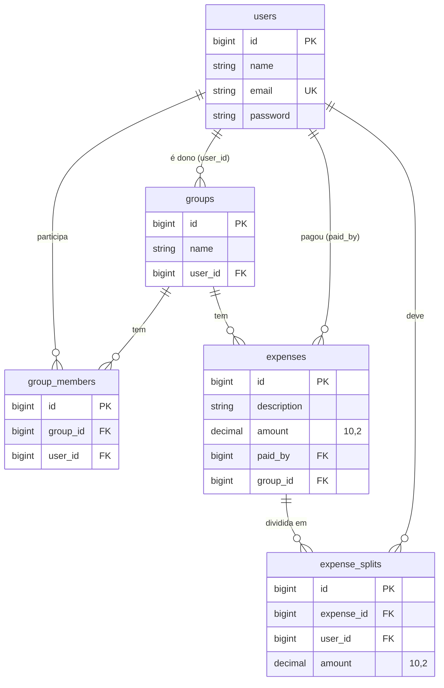

# Arquitetura

O Artel segue a estrutura padrão de uma aplicação Laravel, com uma camada de serviço para a regra de negócio de despesas.

## Organização do código

```text
app/
├── Http/
│   ├── Controllers/
│   │   ├── GroupController.php         # CRUD de grupos
│   │   ├── GroupMemberController.php   # Participantes do grupo
│   │   ├── ExpenseController.php       # Despesas (delega ao ExpenseService)
│   │   ├── GroupBalanceController.php  # Saldos (delega ao ExpenseService)
│   │   └── User/
│   │       ├── RegisterController.php  # Cadastro (rota web)
│   │       └── LoginController.php     # Login por sessão (rota web)
│   └── Requests/                       # Form Requests (validação)
│       ├── StoreGroupRequest.php
│       ├── UpdateGroupRequest.php
│       ├── AddGroupMemberRequest.php
│       └── StoreExpenseRequest.php
├── Models/                             # Eloquent: User, Group, GroupMember, Expense, ExpenseSplit
├── Policies/GroupPolicy.php            # Regras de autorização (ainda não aplicadas)
└── Services/ExpenseService.php         # Divisão de despesas e cálculo de saldos
routes/
├── api.php                             # Rotas REST, prefixo /api
├── web.php                             # Rota "/" e inclusão de user.php
└── user.php                            # /user/register e /user/login
```

O roteamento é configurado em `bootstrap/app.php`. Nesse arquivo também está definido que exceções são renderizadas como JSON para requisições em `api/*` ou que enviem `Accept: application/json`.

## Responsabilidades das camadas

| Camada | Responsabilidade | Observações |
|---|---|---|
| Rotas | Mapear URL e método HTTP para o controller | Usam *route model binding* (`{group}`, `{expense}`, `{user}`): um ID inexistente resulta em 404. |
| Form Requests | Validar a entrada e definir mensagens em português | `authorize()` sempre retorna `true`. `StoreExpenseRequest` também verifica se o pagador participa do grupo. |
| Controllers | Orquestrar a requisição e montar a resposta JSON | `GroupController` e `GroupMemberController` acessam os models diretamente. `ExpenseController` e `GroupBalanceController` delegam ao `ExpenseService`. |
| Service | Regra de negócio de despesas | `createExpense`, `deleteExpense` e `calculateBalance`. As operações de escrita usam `DB::transaction`. |
| Models | Mapeamento das tabelas e relacionamentos | Eloquent. As respostas JSON são os próprios models serializados (não há API Resources). |
| Policy | Regras de autorização para grupos | `GroupPolicy` define `viewAny`, `view`, `update`, `delete`, `addMember` e `removeMember`, mas **não é invocada** pelo código atual. |

## Regras de negócio no `ExpenseService`

### Divisão de despesa (`createExpense`)

1. Se o grupo não tem participantes, lança `InvalidArgumentException` (o controller converte em HTTP 422).
2. Cria a despesa e converte o valor para centavos: `round(amount * 100)`.
3. Divide os centavos igualmente entre os participantes atuais. O resto da divisão é distribuído com 1 centavo a mais para os primeiros participantes da lista.
4. Cria um registro em `expense_splits` para cada participante.

Exemplo: R$ 10,00 entre 3 participantes gera parcelas de 3,34, 3,33 e 3,33.

### Saldo (`calculateBalance`)

Para cada participante atual do grupo:

- `total_paid`: soma das despesas do grupo em que ele é o `paid_by`;
- `total_owed`: soma das suas parcelas (`expense_splits`) nas despesas do grupo;
- `net_balance = total_paid - total_owed`, arredondado para 2 casas decimais;
- `status`: `a_receber` (saldo > 0), `a_pagar` (saldo < 0) ou `quitado` (saldo = 0).

!!! note
    As parcelas são definidas no momento do registro da despesa. Participantes adicionados depois não entram na divisão das despesas anteriores, e o saldo considera apenas quem é participante no momento da consulta.

## Banco de dados



- Todas as tabelas acima têm `created_at` e `updated_at`.
- `group_members` tem índice único em (`group_id`, `user_id`).
- Todas as chaves estrangeiras usam `cascadeOnDelete`. Por exemplo, excluir um grupo remove seus participantes, despesas e parcelas.

### Relacionamentos Eloquent

| Model | Relacionamentos |
|---|---|
| `User` | `ownedGroups` (hasMany Group), `groups` (belongsToMany Group via `group_members`), `expenses` (hasMany Expense por `paid_by`), `expenseSplits` (hasMany ExpenseSplit) |
| `Group` | `owner` (belongsTo User por `user_id`), `members` (belongsToMany User via `group_members`), `expenses` (hasMany Expense) |
| `Expense` | `payer` (belongsTo User por `paid_by`), `group` (belongsTo Group), `splits` (hasMany ExpenseSplit) |
| `ExpenseSplit` | `expense` (belongsTo Expense), `user` (belongsTo User) |
| `GroupMember` | `group` (belongsTo Group), `user` (belongsTo User). O código atual manipula a tabela pivô pela relação `members`, sem usar este model. |
