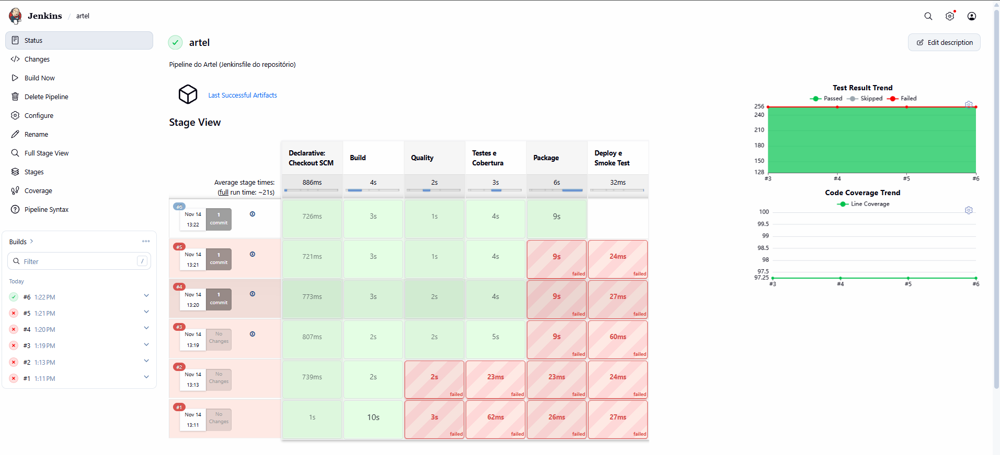

# CI/CD e deploy

A pipeline do Artel roda no **Jenkins** (`Jenkinsfile` na raiz) e publica no Fly.io a partir da `main`.

```text
Build → Quality → Testes e Cobertura → Package → Deploy e Smoke Test (somente main)
```

| Etapa | O que faz |
|---|---|
| Build | `composer validate`, `composer install`, `.env` e `key:generate` |
| Quality | Laravel Pint (`--test`), Larastan (`phpstan analyse`) e `composer audit` |
| Testes e Cobertura | PHPUnit com PCOV, relatórios JUnit e de cobertura |
| Package | `composer install --no-dev`, caches de produção e pacote `.tar.gz` com `sha256` |
| Deploy e Smoke Test | `fly deploy` no app `artel-c14` e `GET /up` esperando HTTP 200 |

Qualquer falha interrompe as etapas seguintes.

## Jenkins

O servidor local é descrito em [`ci/jenkins/README.md`](https://github.com/C14-Inatel-2026-2/Artel/blob/main/ci/jenkins/README.md).

- Plugins: Pipeline, Git, JUnit, Coverage e Credentials Binding.
- O agente precisa de PHP 8.4 (`pdo_sqlite`, `mbstring`, `dom`, `xml`), Composer, `curl` e PCOV ou Xdebug.
- Publica JUnit, cobertura Cobertura e HTML, e arquiva o pacote.
- O stage de deploy roda somente na `main` e exige a credencial **`fly-api-token`**. Sem ela, o build da `main` falha nesse stage. As outras branches param no Package.

!!! note "Sem status no GitHub"
    O Jenkins roda localmente e não reporta o resultado aos commits e PRs. Os builds precisam ser disparados no servidor da equipe.

### Subir o Jenkins local

Pré-requisito: Docker e Docker Compose.

1. Suba o servidor a partir da raiz do repositório:

    ```bash
    docker compose -f ci/jenkins/compose.yml up -d
    ```

2. Abra [http://localhost:8080](http://localhost:8080) e obtenha a senha inicial:

    ```bash
    docker exec jenkins cat /var/jenkins_home/secrets/initialAdminPassword
    ```

3. No assistente inicial, escolha **Install suggested plugins** e crie o usuário administrador.
4. Em **Manage Jenkins → Plugins**, confirme os plugins **Pipeline**, **Git**, **JUnit**, **Coverage** e **Credentials Binding**.
5. Garanta as ferramentas no agente que executa o job (`agent any`: por padrão, o próprio controller). A imagem `jenkins/jenkins:lts` não traz PHP 8.4 (`pdo_sqlite`, `mbstring`, `dom`, `xml`), Composer, `curl` nem PCOV/Xdebug, então instale esses itens no container ou configure um agente que já os tenha.
6. Cadastre a credencial `fly-api-token` (veja [Credencial do Fly](#credencial-do-fly)). Ela só é necessária para o deploy na `main`.

### Criar o job apontando para o repositório

1. **New Item → Multibranch Pipeline** (ou **Pipeline**, se for rodar só uma branch), com o nome `artel`.
2. Em **Branch Sources → Git**, informe `https://github.com/C14-Inatel-2026-2/Artel.git`.
3. Em **Build Configuration**, mantenha **by Jenkinsfile** com o caminho `Jenkinsfile`.
4. Salve e use **Scan Multibranch Pipeline Now** (ou **Build Now**). Sem webhook, os builds precisam ser disparados manualmente.
5. Acompanhe pela visão **Stage View** ou **Open Blue Ocean / Pipeline Overview**. O build da `main` executa os cinco estágios. As demais branches terminam no *Package*.

Os relatórios ficam em **Artifacts** do build (`build/reports/`, `build/package/`), e as abas **Tests** e **Coverage** mostram o JUnit e a cobertura.

### Evidências

Build **#6** da pipeline no Jenkins local, com todos os estágios até o *Package* verdes. Os gráficos à direita mostram os **256 testes** passando (*Test Result Trend*) e a **cobertura de linhas de 97,25%** (*Code Coverage Trend*).



Os builds #1 a #5, em vermelho, são as falhas encontradas e corrigidas na pipeline (formatação e tipagem no *Quality* e erros no *Package*).

!!! note "Deploy e Smoke Test"
    O estágio só roda na branch `main` e exige a credencial `fly-api-token`, por isso aparece vazio neste build, executado em uma branch de correção.

### Credencial do Fly

1. Gere um token de deploy:

    ```bash
    fly tokens create deploy -x 999999h -a artel-c14
    ```

2. No Jenkins: **Manage Jenkins → Credentials → Add**, tipo **Secret text**, ID **`fly-api-token`** (exato), com o token como valor.

## Deploy no Fly.io

A demo fica em **https://artel-c14.fly.dev** (região `gru`). Health check: `GET /up`.

!!! warning "Ambiente de demonstração"
    A API pública exige login e restringe o acesso aos grupos do usuário, mas é um ambiente de demonstração. Não use dados reais nesse ambiente.

### Pré-requisitos

- Conta no [Fly.io](https://fly.io) e CLI `flyctl` (`curl -L https://fly.io/install.sh | sh`)
- Login: `fly auth login`
- App `artel-c14` e volume `artel_data` (montado em `/data`) já criados

### Deploy manual

Na raiz do repositório (com `fly.toml`):

```bash
fly deploy --app artel-c14
```

Secrets do app (já configurados; regenere só se necessário):

```bash
fly secrets set APP_KEY="$(php artisan key:generate --show)" APP_URL="https://artel-c14.fly.dev" --app artel-c14
```

O container sobe com [`docker/entrypoint.sh`](https://github.com/C14-Inatel-2026-2/Artel/blob/main/docker/entrypoint.sh): ajusta a porta (`PORT=8080`), garante o SQLite em `/data/database.sqlite`, roda `php artisan migrate --force` e inicia o Apache. Configuração versionada em `fly.toml` e `Dockerfile`.

### Pausar entre demos

Para zerar o custo de máquina:

```bash
fly scale count 0 --app artel-c14 --yes
```

A URL fica indisponível até religar. O volume `artel_data` (1 GB) continua existindo e tem um custo mínimo de armazenamento (~US$ 0,15/mês). Para eliminar esse custo, apague o volume ou o app (`fly apps destroy artel-c14`), o que também remove o SQLite da demo.

Um novo build da `main` no Jenkins religa o app. Para religar manualmente:

```bash
fly deploy --app artel-c14
```

Confirme com `fly status --app artel-c14` e `curl -I https://artel-c14.fly.dev/up`.
